# Java Application Deployment with Reverse Proxy on AWS

**Project 1 — Internship Assignment**
**Objective:** Deploy a Java-based Student Registration Web Application on AWS with proper database integration and secure reverse proxy access using open-source tools.

---

## 🧭 Architecture / Traffic Flow

```
User Browser
     │
     ▼
Reverse Proxy EC2 (Nginx, Port 80) — Public, Elastic IP attached
     │  proxy_pass → http://<Backend-Private-IP>:8080/student
     ▼
Backend EC2 (Apache Tomcat 9, Port 8080) — Private, no direct public access
     │  JDBC (com.mysql.cj.jdbc.Driver)
     ▼
Amazon RDS (MySQL 8.4, studentdb) — students table
```

The application is publicly reachable **only** through the reverse proxy (`http://<Proxy-Public-IP>/student/`). The backend EC2 is restricted to internal traffic, so it cannot be accessed directly from the internet.

---

## 🛠️ Tools, Services & Configurations Used

| Category | Tool / Service |
|---|---|
| Cloud Provider | AWS (EC2, RDS, Elastic IP, Security Groups) |
| OS | Amazon Linux 2023 |
| Backend Server | Apache Tomcat 9.0.121 (Servlet container) |
| Reverse Proxy | Nginx |
| Database | Amazon RDS (MySQL 8.4-compatible) |
| DB Connector | mysql-connector.jar (placed in Tomcat `lib/`) |
| Application | `student.war` — Java Student Registration Web App |
| Transfer | SCP / SSH (via `project-key.pem`) |

---

## 1️⃣ Infrastructure Setup

Two Linux EC2 instances were launched — one for the backend Java application, one for the reverse proxy.

**Both EC2 instances running:**

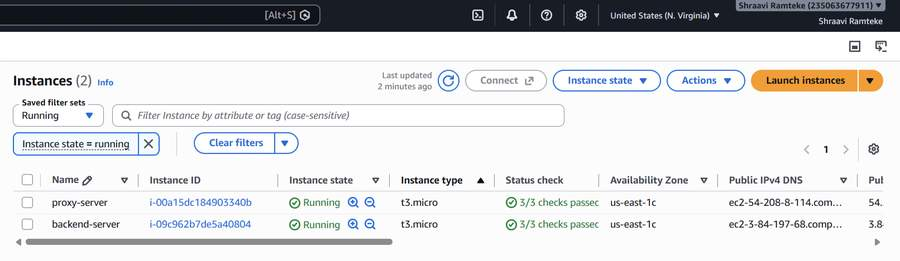

**Security Group — Proxy EC2** (allows HTTP 80 + SSH 22, publicly accessible):

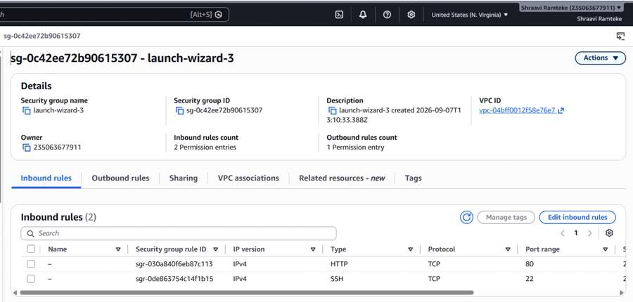

**Security Group — Backend EC2** (allows custom TCP 8080 only, restricted from public direct access):

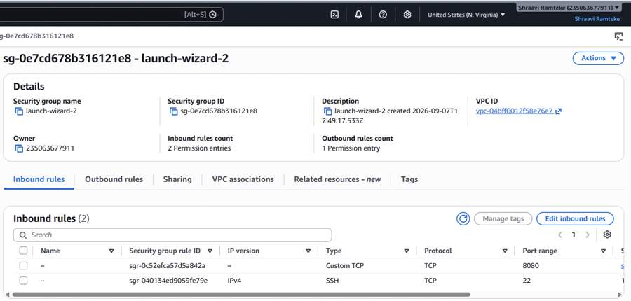

---

## 2️⃣ Application Deployment

Apache Tomcat 9 was downloaded, extracted, and configured on the backend EC2 instance.

**Tomcat download & extraction:**

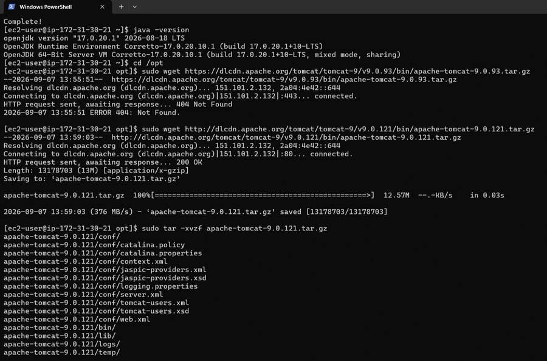

**Fixing permissions & starting Tomcat:**

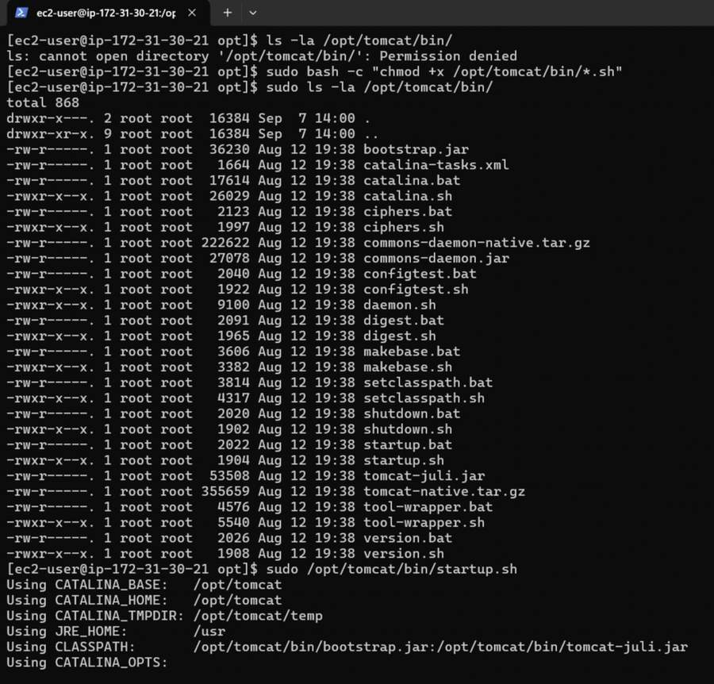

**Tomcat default homepage confirming successful installation (port 8080):**

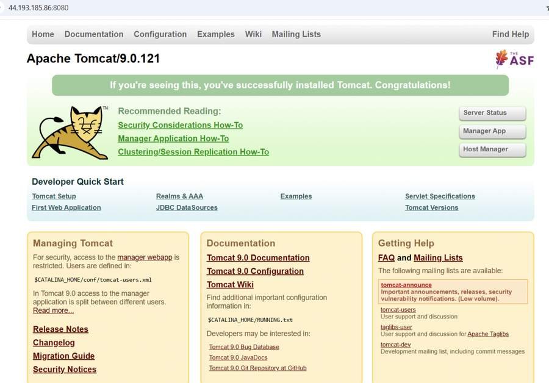

**`student.war` transferred to the backend EC2 via SCP:**

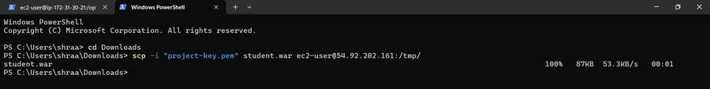

**`student.war` deployed and Tomcat restarted:**

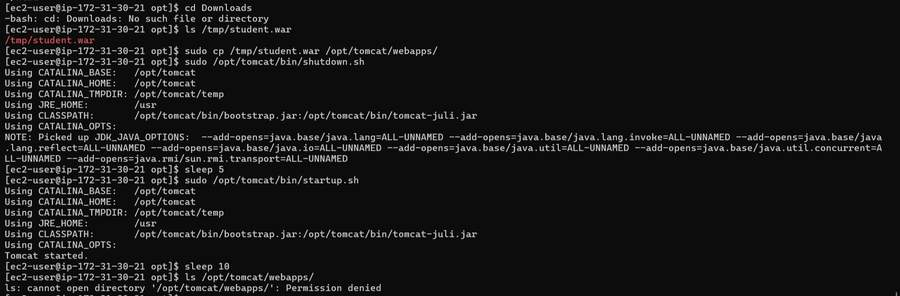

**Webapps directory confirming `student` app is deployed:**

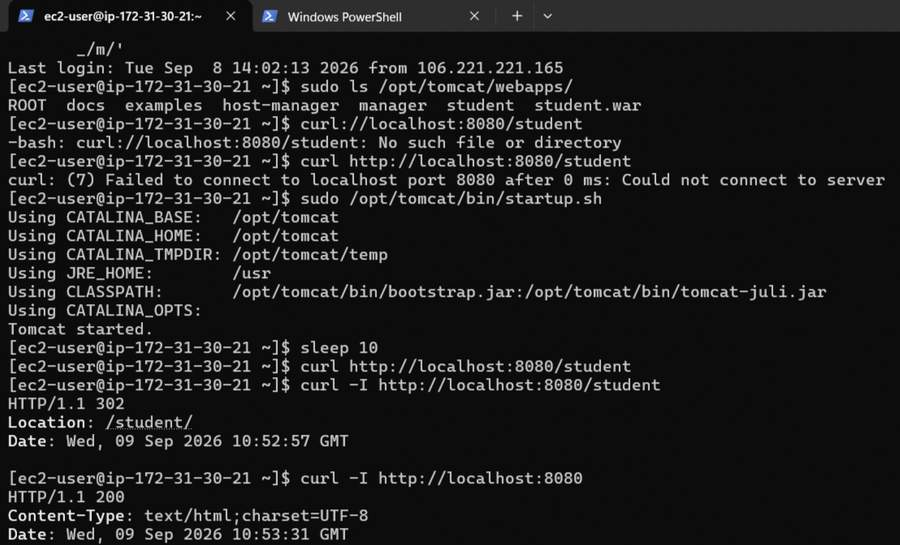

---

## 3️⃣ Database Setup

An Amazon RDS MySQL-compatible database was launched, with a new schema and a `students` table created using SQL DDL.

**RDS database available:**

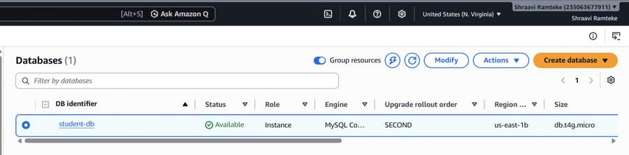

**Default Security Group — RDS inbound rule (MySQL/Aurora 3306):**

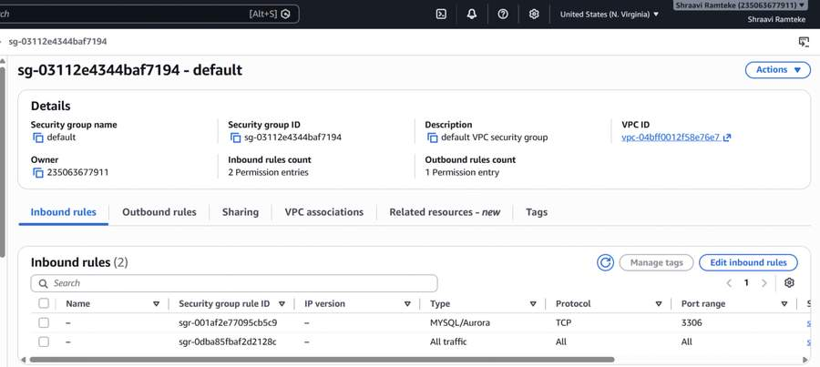

**`students` table created via SQL DDL:**

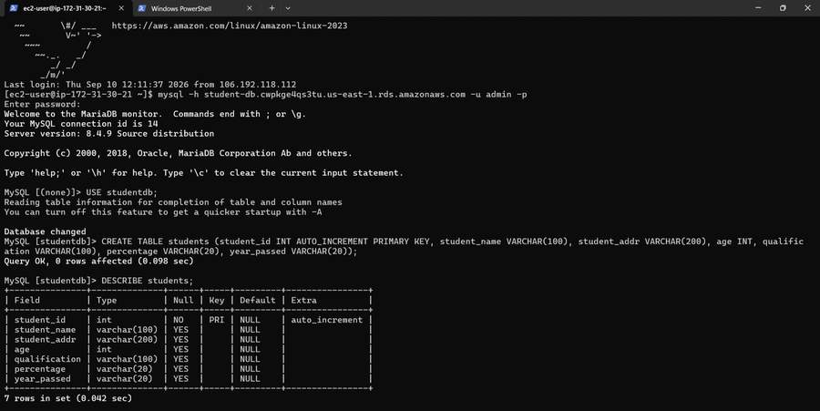

**Column names aligned with the application's DAO layer (renamed via `ALTER TABLE`):**

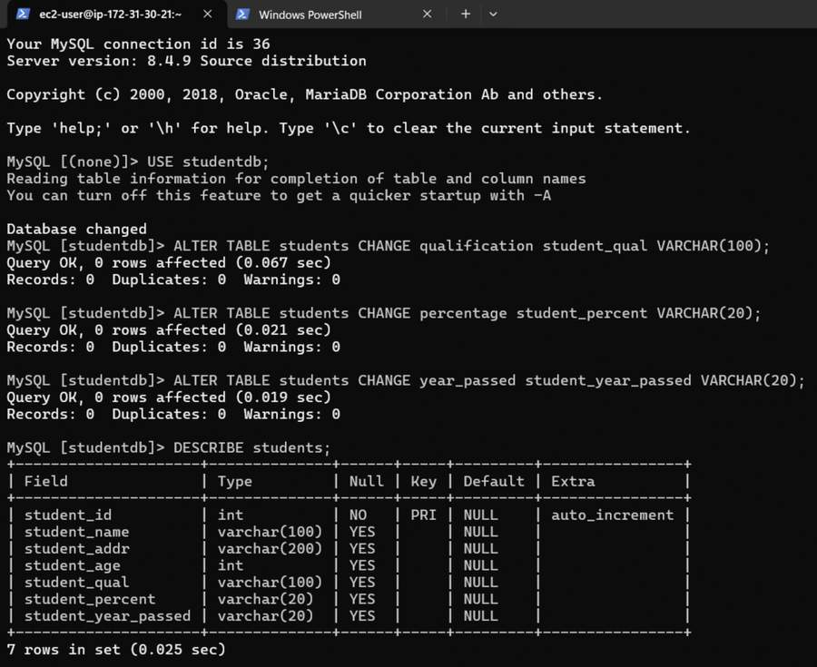

---

## 4️⃣ Database Connector Configuration

The MySQL Connector/J was placed in Tomcat's `lib/` directory, and the JDBC resource was configured in `context.xml` to enable the app's DB connectivity.

**MySQL connector copied to `/opt/tomcat/lib/`:**

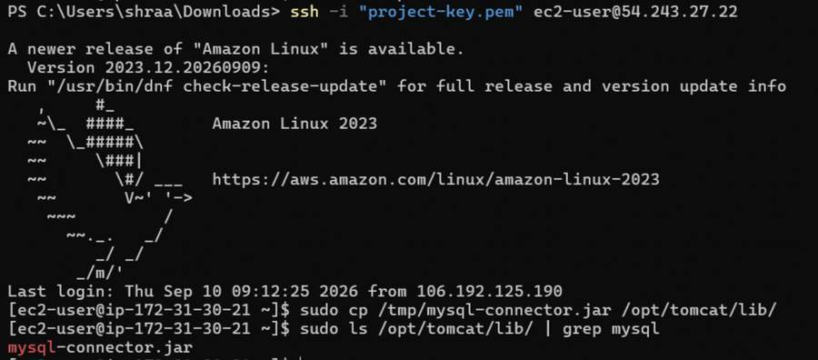

**JDBC resource configuration in `context.xml`:**

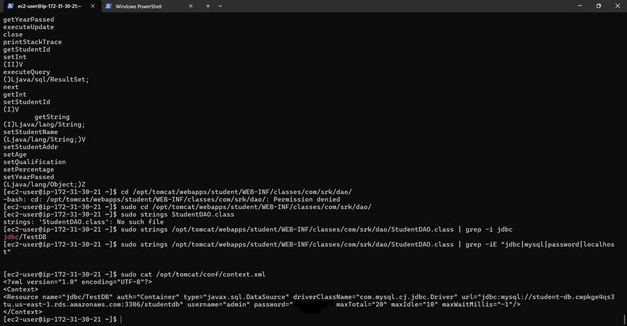

---

## 5️⃣ Reverse Proxy Configuration

Nginx was installed and configured on the proxy EC2 to forward traffic from port 80 to the backend Tomcat server on port 8080.

**Nginx config — `/etc/nginx/conf.d/student.conf`:**

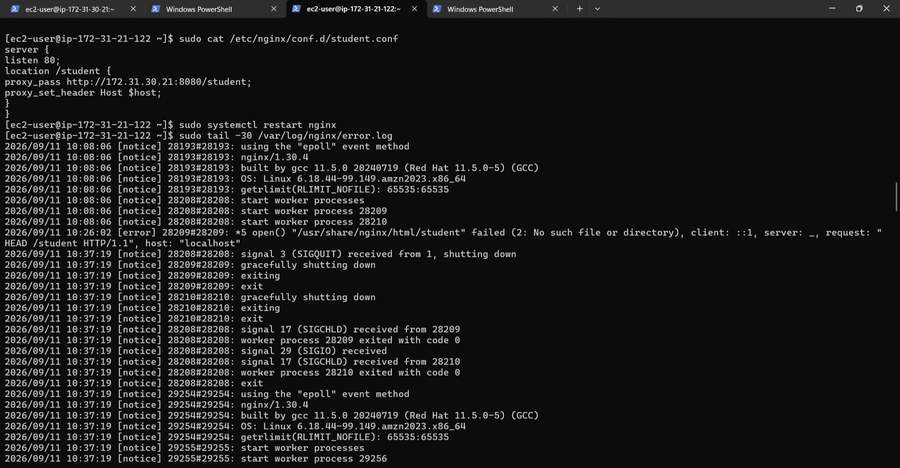

**Nginx active & running, with `curl` tests validating proxy → backend forwarding (`302` redirect confirming the connection):**

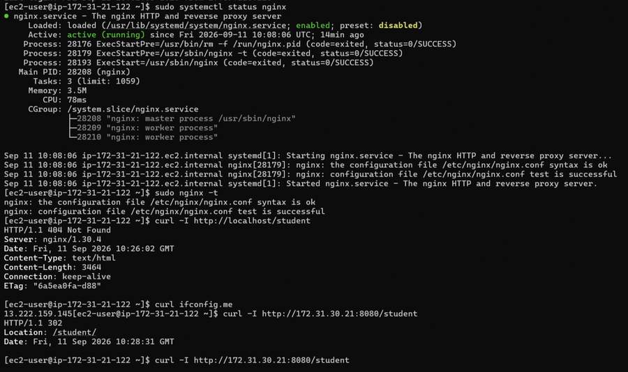

---

## 6️⃣ Access & URL Setup

An Elastic IP was allocated and attached so the application has a stable public entry point via the reverse proxy.

**Elastic IP allocated:**

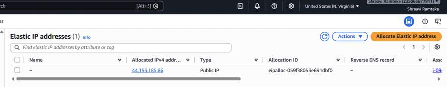

**Application accessible only via the reverse proxy at:**
`http://<Proxy-Instance-Public-IP>/student/`

---

## ✅ Deliverables

### 1. Working Link
The deployed Student Registration Form, accessible only through the reverse proxy:

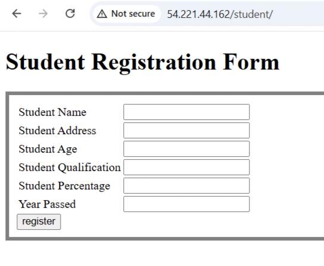

### 2. Screenshot of the Database (stored registration data)
Form submissions successfully stored in the RDS `students` table:

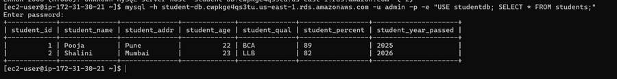

### 2b. Application View — Students List
The application also provides a live view of all registered students directly from the database, confirming end-to-end functionality (form submission → DB storage → retrieval):

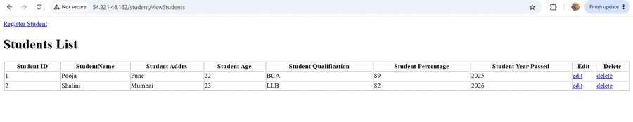

### 3. Summary Report

**Traffic Flow:** Proxy (Nginx, port 80) → Backend (Tomcat, port 8080) → RDS MySQL (port 3306). Only the proxy EC2 is publicly accessible; the backend EC2 is reachable only from within the VPC.

**Tools, Services & Configurations Used:** See the [Tools, Services & Configurations](#️-tools-services--configurations-used) table above.

**Challenges Encountered & Resolutions:**
- **Permission denied errors** on `/opt/tomcat/bin/` and webapps directories — resolved using `sudo chmod +x` on the required scripts and `sudo` for restricted operations.
- **404 Not Found on Nginx** when first testing `/student` — caused by Nginx serving from its default HTML root instead of proxying; resolved by correctly configuring `proxy_pass` in `student.conf` and restarting Nginx.
- **Column name mismatch** between the initial `students` table schema and the application's DAO layer — resolved using `ALTER TABLE ... CHANGE` to rename `qualification`, `percentage`, and `year_passed` to match the app's expected column names (`student_qual`, `student_percent`, `student_year_passed`).
- **Backend not directly accessible (by design)** — verified using `curl` from the proxy EC2 to the backend's private IP on port 8080, confirming the reverse proxy path works while direct public access remains blocked.

---

*All steps completed as per the assignment requirements, with screenshots captured after every step.*
